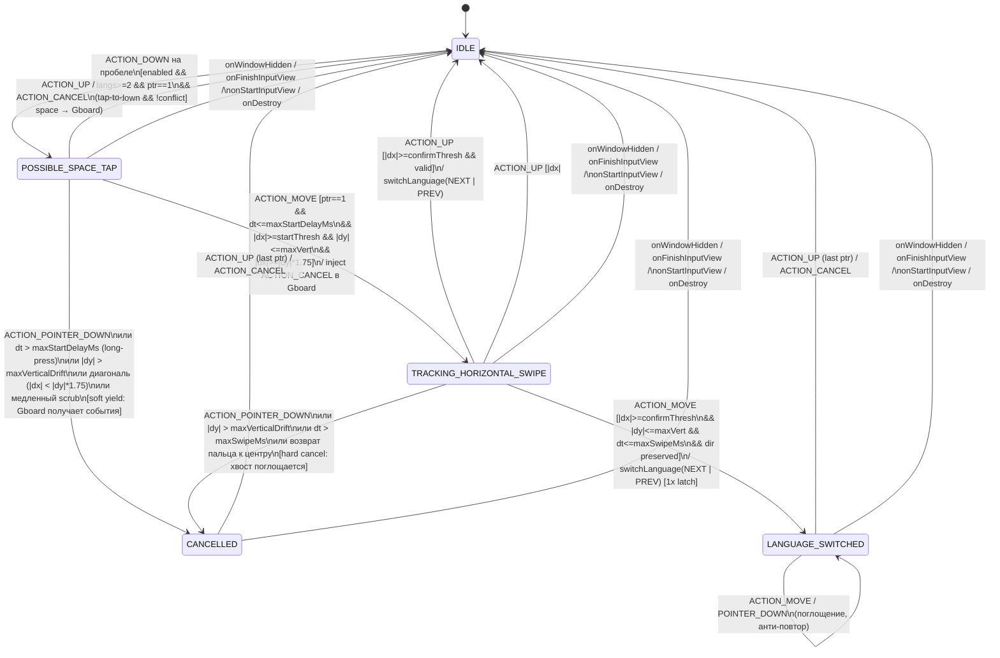

# Архитектура переключения языка свайпом по пробелу (Этап 2)

- **Репозиторий:** `vortexnode/GboardSamsung`
- **Целевое приложение:** Google Gboard (`com.google.android.inputmethod.latin`)
- **Целевая версия Gboard:** `18.5.4.993608717-release-arm64-v8a` (`versionCode = 180698026`)
- **Целевое устройство:** Samsung Galaxy S22 5G (`SM-S901U1`), Android 16 (SDK 36), One UI 8
- **Формат артефакта сборки:** Morphe patch bundle (`.mpp`) для оригинального APK Gboard
- **Статус документа:** Техническая спецификация и верификация аудита (код проекта на данном этапе не изменялся)

> **Принцип верификации:** Каждое утверждение о существующем коде подтверждено прямым чтением исходников репозитория с точным путём, классом, методом и номерами строк. Всё, что отсутствует в репозитории и требует декомпиляции/проверки на целевом APK `18.5.4.993608717-release-arm64-v8a` или тестирования на устройстве, явно помечено как **«Не подтверждено в репозитории — требует проверки на APK Gboard 18.5.4»**.

---

## 1. Проверенные факты о текущей реализации Gboard

### 1.1. Ревизия и уточнения к `docs/TECHNICAL_AUDIT.md`

Повторная проверка выводов `docs/TECHNICAL_AUDIT.md` непосредственно по исходному коду выявила **четыре существенных уточнения и исправления**, критически влияющих на архитектуру:

| № | Утверждение в `docs/TECHNICAL_AUDIT.md` | Результат проверки по коду | Влияние на архитектуру |
|---|---|---|---|
| 1 | `docs/TECHNICAL_AUDIT.md:140, 167`: упоминалось отключение `enable_scrub_move` через `GboardCursorTrackpadRuntime` для устранения конфликта со свайпом по пробелу при сохранении `free_cursor`. | **Опровергнуто / критическое уточнение.** `GboardCursorTrackpadPreferencePatch.kt:24-59` и `GboardCursorTrackpadRuntime.java:11-30` **никогда не возвращают `false`** — они форсируют `enable_scrub_move` (`Lqvt;->am(String, Z, Z)Z`) и ресурс `0x7f14096b` (`Lcht;->x(I, Z)Z`) в `true` (`stock \|\| GboardCursorTrackpadSettings.readEnabled(prefs)`). В Gboard `18.5.4` режим `free_cursor` / `free_cursor_lock_mode` структурно зависит от включённой настройки `enable_scrub_move`. | **Нельзя** слепо форсировать `enable_scrub_move = false`, иначе с высокой вероятностью сломается long-press cursor trackpad (`free_cursor`). Арбитраж жестов обязан строиться через приоритет системных жестов и перехват на уровне `MotionEvent` (либо явную политику совместимости с `enable_scrub_move`). |
| 2 | `docs/TECHNICAL_AUDIT.md:170`: указано, что отправка `Lohe;` с keycode `-0x271b` через `Lphr;->aw(Lohe;)Z` подтверждена для переключения на следующий язык. | **Частично неточно (нужно разделять чтение и синтез).** В коде подтверждено, что `Lphr;->aw(Lohe;)Z` **принимает** входящие события `Lohe;`, а стоковая кнопка Globe генерирует `PRESS` с `entry.c == -0x271b` (`-10011`), `entry.e == "globe"` (`GboardLongPressQuickActionsReflectionHandles.java:223-230`, `GboardGlobeDragAdapter.java:10, 78-96`, `GboardLongPressQuickActionsInputEventPatch.kt:62-66`). Однако **ни один класс в репозитории не конструирует новый объект `Lohe;`** и не вызывает `Lphr;->aw(Lohe;)Z` синтетически; конструктор/фабрика `Lohe;` отсутствует в `gboard-version-bindings.json`. | Для синтетического переключения языка потребуется либо проверка конструктора/фабрики `Lohe;` и внутреннего менеджера `InputMethodEntry` на APK `18.5.4`, либо подтверждённый вызов через `Lqij;->o(...)V` (сигнатура и конструктор `Lqbc;` уже есть в коде — см. раздел 2). |
| 3 | `docs/TECHNICAL_AUDIT.md:122-123`: указано `View ID: 0x7f0b05b5 (GboardSpacebarLogoAdapter.java:17)` и `Keycode: 62 (GboardSpacebarLogoAdapter.java:18)`. | **Незначительная перестановка номеров строк.** В `GboardSpacebarLogoAdapter.java:17-19`: строка **17** — `KEYCODE_SPACE = 62`, строка **18** — `SPACEBAR_VIEW_ID = 0x7f0b05b5`, строка **19** — `PRIMARY_LABEL_VIEW_ID = 0x7f0b05f5`. | Не влияет на логику, исправлено для точности ссылок. |
| 4 | `docs/TECHNICAL_AUDIT.md:155-156`: `KeyboardViewHolder.dispatchTouchEvent(MotionEvent)` указана как готовая точка перехвата наряду с `GboardSwipeDismissBytecodePatch.kt`. | **Критическая деталь реализации Morphe.** `GboardSwipeDismissBytecodePatch.kt:38-44` жёстко проверяет, что **первая инструкция** `KeyboardViewHolder.dispatchTouchEvent(MotionEvent)Z` ещё не переписана (`instructions.first().isMethodReference(SWIPE_DISMISS_RUNTIME_ON_HEADER_TOUCH)`), и при совпадении тихо завершает работу; а второй независимый патч на тот же метод сломал бы порядок/регистры и идемпотентность. | Для совместной работы `GboardSwipeDismiss` и перехвата свайпа по пробелу в `KeyboardViewHolder.dispatchTouchEvent(MotionEvent)Z` необходимо ввести пятый компоновщик — **`GboardTouchDispatchFamilyComposer`** (по аналогии с четырьмя существующими Family Composers). |

---

### 1.2. Подтверждённые точки обработки касаний, клавиш и жестов

#### A. Уровень Android View (`MotionEvent`): `KeyboardViewHolder.dispatchTouchEvent(MotionEvent)Z`
- **Патч:** `patches/src/main/kotlin/dev/jason/gboardpatches/patches/gboard/features/swipedismiss/GboardSwipeDismissBytecodePatch.kt:23-68`
- **Runtime:** `extensions/extension/src/main/java/dev/jason/gboardpatches/extension/swipedismiss/GboardSwipeDismissRuntime.java:29-125` и `GboardSwipeDismissGesture.java:3-118`
- **Целевой метод Gboard (необфусцированный класс):** `Lcom/google/android/libraries/inputmethod/keyboard/impl/KeyboardViewHolder;->dispatchTouchEvent(Landroid/view/MotionEvent;)Z` (`gboard-version-bindings.json`, ключ `swipe_dismiss_dispatch_touch`).
- **Как работает сейчас:**
  1. Инструкция в прологе `dispatchTouchEvent(MotionEvent)` (до `super`/оригинальной логики) вызывает `GboardSwipeDismissRuntime.onHeaderTouch(p0, p1):Z` (`GboardSwipeDismissBytecodePatch.kt:46-55`). При возврате `true` метод немедленно возвращает `true`, полностью поглощая `MotionEvent`.
  2. `GboardSwipeDismissRuntime.java:37` фильтрует экземпляры `KeyboardViewHolder` по `holder.getId() == headerHolderId` (`keyboard_header_view_holder`). При этом `KeyboardViewHolder` — это общий контейнер Gboard и для шапки, и для тела клавиатуры (`keyboard_body_view_holder` — точное имя ID тела клавиатуры требует подтверждения на APK `18.5.4`, но проверка принадлежности касания пробелу надёжнее делать через зарегистрированный `SoftKeyView` пробела, а не только через ID контейнера).
  3. Проверенный механизм отмены уже доставленного дочерним View нажатия (`GboardSwipeDismissRuntime.java:92-100`): при подтверждении жеста отправляется синтетический `MotionEvent.obtain(event)` с `MotionEvent.ACTION_CANCEL` через `holder.dispatchTouchEvent(cancelEvent)` под защитой `ThreadLocal<Boolean> CANCELLING`, чтобы избежать рекурсии.
  4. `GboardSwipeDismissRuntime.resolveInputMethodService(View)` (`lines 108-124`) извлекает активный `InputMethodService` (`Lphr;`) из любого `View` через обход `ContextWrapper` без reflection.

#### B. Уровень привязки `SoftKeyView` и `SoftKeyDef`: `GboardSoftKeyFamilyComposer.kt`
- **Компоновщик:** `patches/src/main/kotlin/dev/jason/gboardpatches/patches/gboard/shared/GboardSoftKeyFamilyComposer.kt:1-471`
- **Целевой метод Gboard:** `Lcom/google/android/libraries/inputmethod/widgets/SoftKeyView;->s()V` (`softkey_view_bind` в `gboard-version-bindings.json`).
- **Контракт вызовов:** оборачивает `SoftKeyView.s()` двумя хуками — `beforeSoftKeyBound(SoftKeyView)` в начале метода (`GboardSoftKeyFamilyComposer.kt:356-369`) и `afterSoftKeyBound(SoftKeyView)` перед каждым `return-void` (`lines 370-390`). Поддерживает цепной вызов выбранных фич (`selected_only_call_chain = true`).
- **Подтверждённая идентификация пробела:**
  - `extensions/extension/src/main/java/dev/jason/gboardpatches/extension/spacebarlogo/GboardSpacebarLogoAdapter.java:17-19`:
    - `KEYCODE_SPACE = 62` (строка 17);
    - `SPACEBAR_VIEW_ID = 0x7f0b05b5` (строка 18);
    - `PRIMARY_LABEL_VIEW_ID = 0x7f0b05f5` (строка 19).
  - `GboardSpacebarLogoAdapter.java:53-77` (`isSpacebarKey`): проверяет `softKeyView.getId() == 0x7f0b05b5` **и** извлекает `SoftKeyDef` из `SoftKeyView` (`field c` через `GboardSoftKeyDefReflectionHandles`), проверяя, что `PRESS` action имеет `keyCode == 62` (`lines 79-118`).
  - `GboardSpacebarLogoAdapter.java:149-165` (`findPrimaryLabelView`): находит дочерний `TextView` с ID `0x7f0b05f5` внутри `SoftKeyView` пробела, где Gboard отображает название текущего языка.
  - `GboardTopRowSwipeRuntimeSupport.java:398-405, 518-553` дополнительно подтверждает поля `SoftKeyDef`: `f` (`int` keyId), `h` (массив `ActionDef`), `i` (`List<CharSequence>` тексты меток), `j` (`int[]` ID дочерних View меток).

#### C. Уровень владения указателями (`PointerTracker`): `GboardPointerOwnerTransformation.kt`
- **Трансформация:** `patches/src/main/kotlin/dev/jason/gboardpatches/patches/gboard/shared/GboardPointerOwnerTransformation.kt:1-960`
- **Контракт регистров:** `patches/src/main/kotlin/dev/jason/gboardpatches/patches/gboard/shared/GboardPointerOwnerRegisterContract.kt:7-37` (`stockRegisterCount = 21`, `expandedRegisterCount = 28`; делегаты `p0`/`p1` или `v14`/`v15`).
- **Целевой класс и методы Gboard (`gboard-version-bindings.json`, `18.5.4`):**
  - `Lqin;->B(Lcom/google/android/libraries/inputmethod/widgets/SoftKeyView;FFJI)V` (`pointer_owner_update`): обновление владельца указателя; параметры `p1` = входящий `SoftKeyView`, `v0`/`v1` = координаты `x`/`y`, `v3` = вычисленный hit `SoftKeyView` (`GboardPointerOwnerTransformation.kt:642`, `GboardTopRowSwipePointerPatch.kt:88`).
  - `Lqin;->m:Lcom/google/android/libraries/inputmethod/widgets/SoftKeyView;` (`pointer_owner_field`, `GboardZhuyinSlideRuntimeSupport.java:67`): текущий `SoftKeyView` владельца указателя.
  - `Lqin;->r(JI)V` (`pointer_finish`): завершение касания, внутри вызывает `Lqio;->f(...)V` (`GboardPointerOwnerTransformation.kt:202-214`).
  - `Lqin;->s(J)V` (`pointer_cancel`): отмена касания; верифицированное 8-инструкционное тело в `18.5.4` вызывает `Lqsl;->a(J)V`, `Lqio;->k()V`, сбрасывает `Lqin;->O:Z` (`GboardPointerOwnerTransformation.kt:219-234`).
  - `Lqin;->C()V` (`pointer_reset`): вызывает `s(J)V` и `ac()V` (`lines 236-248`).
  - `Lqin;->ac()V` (`pointer_pre_reset`).
  - `Lqin;->y()V` (`scheduleLongPress`) и поле `Lqin;->A:Ljava/util/concurrent/Future;` (`longPressFutureField`) — подтверждено в `GboardLongPressQuickActionsReflectionHandles.java:114, 361` (используется `GboardGlobeDragRuntime.java:365-372` для отмены запланированного long-press!).
  - `Lqin;->i()Lqae;` (`currentAction`) и `Lqin;->h(FFLqae;)Lqae;` (`resolveGestureAction`) — `GboardZhuyinSlideRuntimeSupport.java:90-92`.
- **Важное ограничение `Lqin;->B` для пробела:** `Lqin` относится к базовому обработчику клавиш (`BasicMotionEventHandler`). По исходникам репозитория **не подтверждено**, вызывается ли `Lqin;->B` на каждом шаге `ACTION_MOVE`, пока палец остаётся внутри одного и того же широкого `SoftKeyView` пробела, и перехватывает ли `ScrubMoveMotionEventHandler` события раньше `Lqin`. Напротив, `KeyboardViewHolder.dispatchTouchEvent(MotionEvent)` гарантированно получает **каждый** `ACTION_DOWN`, `ACTION_MOVE`, `ACTION_POINTER_DOWN`, `ACTION_UP`, `ACTION_CANCEL` до любых `MotionEventHandler` Gboard.

#### D. Уровень диспетчеризации жестов: `GboardGestureFamilyComposer.kt`
- **Компоновщик:** `patches/src/main/kotlin/dev/jason/gboardpatches/patches/gboard/shared/GboardGestureFamilyComposer.kt:1-670`
- **Целевой метод Gboard:** `Lqil;->f(Lqin;Lqae;Lqbc;Lcom/google/android/libraries/inputmethod/metadata/SoftKeyDef;JZZIZJI)V` (`gesture_dispatch` в `gboard-version-bindings.json`).
- **Стоковое поведение:** пробрасывает все аргументы в поле `Lqil;->n:Lqij;` методом `Lqij;->o(...)V` (`GboardGestureFamilyComposer.kt:334-361`).
- **Роль в проекте:** позволяет на уровне Gboard подавить/переписать действие (например, не допустить случайную отправку `KEYCODE_SPACE = 62` при завершении распознанного свайпа по пробелу) и предоставляет доступ к полям `Lqil;->b:Landroid/content/Context;` (`GboardTopRowSwipeRuntimeSupport.java:452`) и `Lqil;->c:Lqvt;` (`GboardZhuyinTraditionalSimplifiedToggleRuntimeSupport.java:96`).

#### E. Уровень событий IME и жизненного цикла `InputMethodService`: `Lphr;`
- **Подтверждённые биндинги `Lphr;` в `gboard-version-bindings.json` (`18.5.4`):**
  - `Lphr;->aw(Lohe;)Z` (`long_press_input_event_handler`, `latin_globe_key_ignore_interval_event_handler`);
  - `Lphr;->onCreate()V`, `onStartInput(EditorInfo, Z)V`, `onStartInputView(EditorInfo, Z)V`, `onFinishInput()V`, `onFinishInputView(Z)V`, `onWindowShown()V`, `onWindowHidden()V`, `onDestroy()V`, `onUpdateSelection(IIIIII)V`, `onConfigureWindow(Window, Z, Z)V`;
  - `Lphr;->at(Z)V` (`swipe_dismiss_request_hide` — скрытие клавиатуры);
  - `Lphr;->i:Lcom/google/android/libraries/inputmethod/inputview/InputView;` (`calculator_input_view`).
- **Подтверждение типа:** `InputMethodService.class.isAssignableFrom(Lphr;)` проверяется в `GboardLongPressQuickActionsReflectionHandles.java:457`.

#### F. Уровень `RuntimeAbi.kt` и реестра патчей `GboardPatchRegistry.kt` / `GboardContributionWiring.kt`
- `patches/src/main/kotlin/dev/jason/gboardpatches/patches/gboard/shared/runtimeabi/RuntimeAbi.kt:1-215`: централизованный контракт всех Java-методов extension-модуля, вызываемых из сгенерированного Smali-байткода (классы, имена методов, точные дескрипторы). Все новые байткод-хуки обязаны декларировать целевые Java-методы здесь и проходить проверку целостности ABI.
- `patches/src/main/kotlin/dev/jason/gboardpatches/patches/gboard/registry/GboardContributionWiring.kt:1-222`: единая таблица привязки `feature_id` → `contribution_id` → байткод-/ресурс-патчи, сверяемая с `gboard-port-product-catalog.json` и `gboard-version-bindings.json`.
- `patches/src/main/kotlin/dev/jason/gboardpatches/patches/gboard/registry/GboardPatchRegistry.kt:175-989`: публичные патчи регистрируются через `gboardPublicResourcePatch(...)` и включаются в `GboardPublishedPatchCatalog.morpheRegistrations`.

#### G. Анализ `GboardLatinGlobeKeyIgnoreIntervalBytecodePatch.kt` и `GboardLatinGlobeKeyIgnoreIntervalRuntime.java`
- **Патч:** `patches/src/main/kotlin/dev/jason/gboardpatches/patches/gboard/features/latinglobe/GboardLatinGlobeKeyIgnoreIntervalBytecodePatch.kt:1-217`
- **Runtime:** `extensions/extension/src/main/java/dev/jason/gboardpatches/extension/keyboard/GboardLatinGlobeKeyIgnoreIntervalRuntime.java:1-221`
- **Что реально делает патч:**
  - Хукает `Lphr;->aw(Lohe;)Z` (событие ввода) и `Lcom/google/android/apps/inputmethod/libs/latin5/LatinIme;->N()Lyrt;` (получение объекта состояния/таймера LatinIme).
  - Сбрасывает дебаунс/интервал игнорирования клавиши Globe сразу после набора текста в LatinIme, чтобы быстрое нажатие Globe срабатывало без задержки.
  - **Вывод для нашей задачи:** этот патч **не реализует** само переключение языка (не содержит ссылок на менеджер `InputMethodEntry` и не вызывает `switchToNext/Previous`), но подтверждает, что события с `-0x271b` проходят через `Lphr;->aw(Lohe;)Z` и что на `Lphr;->aw(Lohe;)Z` уже есть два потребителя (`GboardLongPressQuickActionsInputEventPatch` и `GboardLatinGlobeKeyIgnoreIntervalBytecodePatch`), которые **нельзя конфликтно перезаписывать**.

---

### 1.3. Ответы на ключевые вопросы Части 1

1. **Где именно Gboard получает события касания пробела?**
   - Сначала в `KeyboardViewHolder.dispatchTouchEvent(MotionEvent)Z` (Android View hierarchy, подтверждено: `GboardSwipeDismissBytecodePatch.kt:23-68`).
   - Затем внутри `SoftKeyboardView` события распределяются между зарегистрированными `MotionEventHandler` (включая `ScrubMove`, `GlideTyping`, `BasicMotionEventHandler`/`Lqin`).
2. **Как определяется нажатие и отпускание пробела?**
   - На уровне `MotionEvent`: `ACTION_DOWN` в координатах видимого `SoftKeyView` пробела (`id == 0x7f0b05b5`, `pressKeycode == 62`, подтверждено `GboardSpacebarLogoAdapter.java:17-18, 53-118`) и завершение `ACTION_UP` / `ACTION_CANCEL`.
   - На уровне движка Gboard: `Lqin;->B(...)V` (привязка указателя), `Lqin;->r(J, I)V` (завершение), `Lqin;->s(J)V` (отмена), `Lqil;->f(...)V` → `Lqij;->o(...)V` (диспетчеризация `PRESS`/`LONG_PRESS` с `keyCode == 62`).
3. **Можно ли безопасно перехватить горизонтальный свайп, не нарушая существующую обработку?**
   - **Да**, при перехвате в `KeyboardViewHolder.dispatchTouchEvent(MotionEvent)Z` через новый компоновщик `GboardTouchDispatchFamilyComposer`: в состоянии `POSSIBLE_SPACE_TAP` события **пропускаются дальше** в Gboard без модификации (tap-to-space, long-press и вертикальные/короткие движения работают нативно), а при строгом переходе в `TRACKING_HORIZONTAL_SWIPE` / `LANGUAGE_SWITCHED` в дочерние View Gboard отправляется синтетический `ACTION_CANCEL` (уже проверенный механизм `GboardSwipeDismissRuntime.java:92-100`), сбрасывающий `Lqin` и отменяющий запланированный long-press.
4. **Что доступно через reflection, а что требует bytecode/Smali-патча?**
   - **Доступно без нового байткода (через существующие API / reflection):**
     - получение `InputMethodService` (`Lphr;`) через `ContextWrapper` (`GboardSwipeDismissRuntime.resolveInputMethodService`);
     - чтение `SoftKeyDef`, `ActionDef`, `keyCode == 62`, текста и `TextView 0x7f0b05f5` пробела (`GboardSpacebarLogoAdapter`, `GboardTopRowSwipeRuntimeSupport`);
     - `InputMethodService.switchToNextInputMethod(boolean)` / `switchToPreviousInputMethod()` (публичные API Android, но см. ограничения в разделе 2);
     - `Lqbc` конструктор `(int, Lqbb;, Object, int)` и поля `Lqin` / `Lohe` (`GboardLongPressQuickActionsReflectionHandles.java:98-123`).
   - **Требует bytecode/Smali-патча:**
     - перехват `KeyboardViewHolder.dispatchTouchEvent(MotionEvent)Z` (через `GboardTouchDispatchFamilyComposer`);
     - регистрация пробела и отрисовка индикатора в `SoftKeyView.s()` (через `GboardSoftKeyFamilyComposer`);
     - сброс состояния при скрытии/смене окна в `Lphr;->onWindowHidden()`, `onFinishInputView(Z)`, `onStartInputView(EditorInfo, Z)`, `onDestroy()`;
     - (после проверки APK `18.5.4`) привязка внутреннего менеджера `InputMethodEntry` / обработчика переключения языка для точного циклического перехода Next и Previous.

---

## 2. Результаты исследования переключения языков

### 2.1. Что строго подтверждено в репозитории

1. **Keycode переключения на следующий язык (Globe tap):**
   - Константа `KEYCODE_SWITCH_TO_NEXT_LANGUAGE = -0x271b` (`-10011`), payload `"globe"`, действие `qae.PRESS`.
   - Подтверждено в:
     - `extensions/extension/src/main/java/dev/jason/gboardpatches/extension/longpressquickactions/GboardGlobeDragAdapter.java:10, 78-96`;
     - `extensions/extension/src/main/java/dev/jason/gboardpatches/extension/longpressquickactions/GboardLongPressQuickActionsReflectionHandles.java:27, 223-230`.
2. **Keycode диалога выбора языка (Globe long-press):**
   - Константа `KEYCODE_SHOW_LANGUAGE_PICKER = -0x2726` (`-10022`), payload `"globe"`, действие `qae.LONG_PRESS`.
   - Подтверждено в `GboardLongPressQuickActionsReflectionHandles.java:28, 223-230`.
3. **Точки прохождения события:**
   - На уровне жестов клавиш: `Lqil;->f(Lqin;Lqae;Lqbc;SoftKeyDef;JZZIZJI)V` → `Lqil;->n:Lqij;` → `Lqij;->o(...)V` (`GboardGestureFamilyComposer.kt:334-361`).
   - На уровне IME: `Lphr;->aw(Lohe;)Z` (`GboardLongPressQuickActionsInputEventPatch.kt:62-66`), где `Lohe;` содержит поля `a` (`qae` action), `b` (`qbc[]` keyDatas), `c` (`SoftKeyDef`), `w` (`int` subtype/source).
   - Конструктор `Lqbc(int keyCode, Lqbb intention, Object data, int unused)` подтверждён в `GboardLongPressQuickActionsReflectionHandles.java:102-103`.

### 2.2. Что НЕ подтверждено в репозитории (требует проверки на APK Gboard `18.5.4.993608717-release-arm64-v8a`)

Честная фиксация пробелов (выдумывание символов и keycodes запрещено):

1. **Механизм переключения на предыдущий язык (`Previous Language`) в репозитории НЕ найден.**
   - Поиск по всему репозиторию (`patches/src/main`, `extensions/extension/src/main/java`) подтвердил отсутствие констант/ссылок на `SWITCH_TO_PREVIOUS_LANGUAGE`, `-0x271c` (`-10012`), `InputMethodEntryManager`, `getEnabledInputMethodEntries`, `switchToPreviousLanguage`.
2. **Класс-менеджер активных языков Gboard (`InputMethodEntryManager` / `IInputMethodEntryManager`) в `gboard-version-bindings.json` отсутствует.**
   - В Gboard языки/раскладки управляются внутренним списком `InputMethodEntry` (а не только системными `InputMethodSubtype` Android!).
   - Системные методы `InputMethodService.switchToNextInputMethod(boolean)` и `switchToPreviousInputMethod()` работают **только на уровне системных IME/subtypes Android** и в современном Gboard (где несколько языков/раскладок хранятся внутри одного IME без регистрации отдельных системных подтипов или с ограниченной синхронизацией) **часто переключают на другую клавиатуру (например, Samsung Keyboard / Voice) вместо следующего/предыдущего языка внутри Gboard**. Поэтому полагаться на системные методы `InputMethodService` как на основной механизм **недопустимо**.
3. **Внутренний порядок активных языков и поведение при 2, 3, 4+ языках:**
   - В стоковом Gboard переключение по Globe (`-0x271b`) часто использует **MRU-логику (most recently used)** или последовательный обход с учётом времени с последнего переключения (если пауза > N секунд — переключение на предыдущий использованный язык, если быстрые повторные нажатия — цикл по списку). Точный алгоритм в `18.5.4` **не подтверждён в репозитории — требует проверки на APK Gboard 18.5.4**.
   - **Критично для UX Samsung:** в Samsung Keyboard свайп вправо всегда идёт к `entries[(index + 1) % N]`, а свайп влево — к `entries[(index - 1 + N) % N]` по **стабильному упорядоченному списку** активных языков (детерминированный цикл, а не MRU!).
4. **Одинаковая раскладка с разными языками (например, English (US) QWERTY + Deutsch QWERTY или Español QWERTY):**
   - В Gboard один и тот же `KeyboardLayout` (`qwerty`) может быть привязан к разным `InputMethodEntry` (различаются `languageTag` / `locale`, словарями и меткой на пробеле) либо объединён в мультиязычную запись (`multilingual`). При переключении через внутренний список `InputMethodEntry` смена происходит по **индексу `InputMethodEntry`**, а не по имени раскладки — это гарантирует корректную работу с одинаковыми раскладками разных языков, если список записей получен напрямую из менеджера `InputMethodEntry`. Поведение при включённой мультиязычной печати (1 `InputMethodEntry` с дополнительными языками) необходимо явно проверить на APK `18.5.4`.
5. **Конструктор/фабрика `Lohe;`:**
   - В репозитории описаны только поля `Lohe;` (`a`, `b`, `c`, `w`), но не конструктор/метод-фабрика (`Lohe;->d()` / `Event.create(...)`). Требуется проверка на APK `18.5.4`.

### 2.3. Архитектурное решение: трёхуровневый адаптер переключения языка (`GboardLanguageSwitcher`)

Чтобы архитектура была полностью детерминированной для 2, 3, 4+ языков и одинаковых раскладок, проектируется изолированный интерфейс `GboardLanguageSwitchBridge` с тремя уровнями (используется наивысший верифицированный уровень):

1. **Уровень 1 (Целевой, основной — обязательный к верификации на APK `18.5.4`): прямой вызов внутреннего менеджера `InputMethodEntry` Gboard.**
   - При инспекции APK `18.5.4` находятся точные обфусцированные символы менеджера записей ввода (аналог `InputMethodEntryManager` в AOSP/Gboard):
     - получение текущего упорядоченного списка активных `InputMethodEntry` (`List<Entry>`),
     - получение текущего активного `InputMethodEntry` (`currentEntry`),
     - метод активации конкретной записи `switchToInputMethodEntry(entry)` (или `switchToNext/Previous` с фиксированным порядком).
   - **Логика переключения:**
     - Если `entries.size() < 2`: переключение не выполняется (свайп не должен перехватываться вообще — см. раздел 3.1).
     - `DIRECTION_NEXT` (слева направо): `targetIndex = (currentIndex + 1) % entries.size()`.
     - `DIRECTION_PREVIOUS` (справа налево): `targetIndex = (currentIndex - 1 + entries.size()) % entries.size()`.
   - **Преимущества:**
     - Истинно симметричное переключение в обе стороны для 2, 3, 4+ языков (детерминированный цикл как в Samsung One UI, без MRU-скачков).
     - Безупречная работа с одинаковыми раскладками разных языков (переключаются `InputMethodEntry`, а не раскладки).
     - Не переключает на сторонние системные клавиатуры (Samsung Keyboard / Voice IME).
     - Даёт мгновенное знание `enabledLanguageCount >= 2` ещё **до** начала свайпа (при 1 языке жест не активируется).
     - Позволяет мгновенно получить локализованное имя следующего/текущего языка для индикатора на пробеле.

2. **Уровень 2 (Резервный при наличии подтверждённых keycode в APK `18.5.4`): синтетическая отправка внутреннего события Gboard (`Lohe;` / `Lqij;->o`).**
   - Для `DIRECTION_NEXT`: отправка `qbc(keyCode = -0x271b, intention = null, data = "globe", ...)` с `qae.PRESS`.
   - Для `DIRECTION_PREVIOUS`: **только если** в APK `18.5.4` подтверждён отдельный keycode предыдущего языка (например, в таблице `KeyCode` рядом с `-0x271b`).
   - **Ограничение:** если в `18.5.4` отсутствует отдельный keycode для `Previous`, Уровень 2 **не может** самостоятельно обеспечить требование «свайп справа налево — предыдущий язык» при 3+ языках (цикл `N-1` раз через `-0x271b` недопустим из-за возможной MRU-логики и мерцания UI). Следовательно, **Уровень 1 является обязательным целевым путём** перед началом реализации.

3. **Уровень 3 (Запрещён как основной; только диагностический fallback):**
   - `InputMethodService.switchToNextInputMethod(true)` / `switchToPreviousInputMethod()` **не используется** в продакшн-логике свайпа по пробелу, так как в Gboard может переключить IME целиком за пределы Gboard и не видит внутренние `InputMethodEntry`.

**Вывод-гейт для Этапа 3:** реализация кода **не начинается**, пока на APK `18.5.4.993608717-release-arm64-v8a` не будут верифицированы биндинги Уровня 1 (менеджер `InputMethodEntry` + метод переключения на конкретный `InputMethodEntry`).

---

## 3. Точная архитектура конечного автомата

Конечный автомат (`GboardSpacebarSwipeStateMachine`) — **чистая Java-логика без зависимости от Android-фреймворка** (для 100% покрытия быстрыми JVM unit-тестами). Работает поверх одного активного указателя (`activePointerId`) и строго детерминированных геометрических и временных инвариантов.

### 3.1. Предусловия активации (Pre-flight Guard в `IDLE`)

Автомат может покинуть состояние `IDLE` при `ACTION_DOWN` **только если одновременно выполняются все условия**:
1. Фича включена в настройках пользователя (`GboardSpacebarSwipeSettings.isEnabled(prefs)`).
2. Устройство не в Direct Boot locked-режиме (`GboardDirectBootSupport.isUserUnlocked(context)`).
3. Количество активных языков Gboard `>= 2` (если установлен 1 язык, касание мгновенно пропускается в Gboard, состояние остаётся `IDLE`).
4. Политика совместимости с `enable_scrub_move` разрешает перехват (см. раздел 6.5).
5. `event.getPointerCount() == 1` (нет других нажатых пальцев).
6. Зарегистрированный `SoftKeyView` пробела валиден, `isShown() == true`, имеет ненулевые размеры и `pressKeycode == 62`.
7. Точка `(rawX, rawY)` попадает внутрь видимого прямоугольника пробела (`spacebarRectOnScreen`) с учётом безопасного нижнего отступа от системной панели жестов One UI 8 (`bottomEdgeExclusionPx`, см. ниже).
8. Не активны конфликтующие состояния: `GboardSwipeDismiss` не активен, `GboardGlobeDrag` не активен, режим `free_cursor` / `free_cursor_lock_mode` не активен, голосовой ввод не активен.

Если хотя бы одно предусловие не выполнено → автомат остаётся в `IDLE`, событие полностью отдаётся в Gboard без вмешательства.

### 3.2. Состояния автомата

| Состояние | Назначение | Пропуск `MotionEvent` в Gboard |
|---|---|---|
| `IDLE` | Ожидание нового касания. Активный указатель отсутствует (`activePointerId = INVALID_POINTER_ID`). | **Да** (все события идут в Gboard). |
| `POSSIBLE_SPACE_TAP` | Зафиксирован `ACTION_DOWN` на пробеле. Пока неизвестно: это обычный тап пробела, long-press trackpad, вертикальное движение, мультитач или начало горизонтального свайпа. | **Да** (события передаются в Gboard, чтобы не ломать подсветку пробела, tap-to-space и long-press; при этом отслеживаются `dx`, `dy`, `dt`). |
| `TRACKING_HORIZONTAL_SWIPE` | Горизонтальное намерение превысило dead-zone (`startTrackingThresholdPx`), палец движется преимущественно по оси X внутри вертикального допуска и до истечения таймаута long-press. Жест «захвачен» для оценки порога подтверждения. | **Нет** (поглощается). При входе в состояние один раз инъецируется `ACTION_CANCEL` в дочерние View Gboard, отменяя нажатие пробела и таймер long-press. |
| `LANGUAGE_SWITCHED` | Превышен порог подтверждения (`confirmThresholdPx`). Переключение языка (`NEXT` или `PREVIOUS`) **выполнено ровно один раз** (latch). Остаток жеста до `ACTION_UP` / `ACTION_CANCEL` поглощается, повторные срабатывания заблокированы. | **Нет** (поглощается до отпускания пальца). |
| `CANCELLED` | Жест дисквалифицирован до подтверждения переключения (причины: `VERTICAL_DRIFT`, `TIMEOUT_LONG_PRESS`, `MULTITOUCH`, `SYSTEM_CANCEL`, `EXTERNAL_RESET`, `SCRUB_YIELD`, `BACKTRACK_ABORT`). До прихода `ACTION_UP` / `ACTION_CANCEL` автомат игнорирует текущий жест. | **Зависит от точки отмены:** если отмена из `POSSIBLE_SPACE_TAP` → **Да** (Gboard продолжает обрабатывать long-press / scrub / мультитач без перебоев!); если отмена из `TRACKING_HORIZONTAL_SWIPE` (где уже был отправлен `ACTION_CANCEL`) → **Нет** (поглощаем хвост, чтобы не создать фантомный tap). |

> **Ключевой инженерный инвариант:** пока автомат находится в `POSSIBLE_SPACE_TAP`, он **не поглощает** `ACTION_DOWN` и ранние микродвижения. Если пользователь просто удерживает пробел (long press → `free_cursor` trackpad) или ставит второй палец (мультитач), переход `POSSIBLE_SPACE_TAP → CANCELLED` происходит **без отправки `ACTION_CANCEL` в Gboard**, поэтому long-press trackpad, tap-to-space и мультитач работают абсолютно нативно, со 100% сохранением поведения Gboard.

### 3.3. Пороговые значения и допуски (обоснованные и настраиваемые)

Все пространственные величины рассчитываются в `dp` (переводятся в `px` через `DisplayMetrics.density`) и масштабируются относительно `ViewConfiguration.get(context).getScaledTouchSlop()` и фактической ширины/высоты пробела (учёт адаптивности, портретной/альбомной ориентации, режима одной руки и разной высоты клавиатуры на Galaxy S22 5G `SM-S901U1`):

| Параметр | Формула / значение по умолчанию | Настройка в UI | Инженерное обоснование |
|---|---|---|---|
| `startTrackingThresholdPx` (dead-zone захвата) | `max(touchSlop * 1.1f, 10dp)` | Нет (внутренний) | Отсеивает естественный микродрожь пальца при обычном нажатии пробела (`tap-to-space`), но достаточно мал, чтобы перехватить быстрый свайп до того, как `ScrubMove` сместит курсор на первый символ. |
| `confirmThresholdPx` (порог подтверждения смены языка) | По умолчанию (Medium): `clamp(spacebarWidth * 0.22f, min = max(touchSlop * 2.0f, 28dp), max = 44dp)` | **Да:** Чувствительность свайпа:<br>• Высокая (короткий свайп): `min=22dp, ratio=0.16f, max=34dp`<br>• Средняя (по умолчанию): `min=28dp, ratio=0.22f, max=44dp`<br>• Низкая (длинный свайп): `min=36dp, ratio=0.30f, max=56dp` | На экране Galaxy S22 5G (ширина ~360dp, ширина пробела ~145–175dp) `0.22 * 160dp ≈ 35dp` — комфортный, осознанный горизонтальный свайп, исключающий случайный триггер при быстром наборе. |
| `maxVerticalDriftPx` (вертикальный допуск) | `min(22dp, spacebarHeight * 0.50f)` | Нет | При уходе пальца вверх на соседний ряд букв (ошибочный старт Glide typing или промах с пробела) жест отменяется. |
| `horizontalDominanceRatio` (соотношение `\|dx\| / \|dy\|`) | `1.75f` (угол к горизонтали `≤ ~29.7°`) | Нет | Надёжно отсекает диагональные движения (`45°`, где `\|dx\| / \|dy\| ≈ 1.0`), не ломая ни пробел, ни Glide typing. |
| `maxStartDelayMs` (окно старта до long-press) | `min(ViewConfiguration.getLongPressTimeout(), 260L)` ms | Нет | Согласовано с `GboardSwipeDismissGesture.java:6` (`300ms`), но взято с запасом `260ms` (против стандартного Android `400ms` long-press), чтобы при удержании пробела автомат **гарантированно** перешёл в `CANCELLED (TIMEOUT_LONG_PRESS)` раньше срабатывания `Lqin;->y()` (long-press trackpad / language picker). |
| `maxTotalSwipeDurationMs` (макс. длительность свайпа) | `450L` ms | Нет | Защита от медленного «ползущего» перетаскивания (характерного для ручного движения курсора при `enable_scrub_move`). Согласовано с `GboardSwipeDismissGesture.java:7` (`500ms`). |
| `minHorizontalVelocityDpPerSec` (мин. скорость при конфликте со scrub) | В обычном режиме: `0` (любая скорость в пределах `450ms`). В режиме совместной работы с `enable_scrub_move`: `180 dp/s` (или `confirmThreshold` за `<= 220ms`). | **Да:** Режим совместимости с движением курсора (см. раздел 6.5) | Разделяет быстрый flick-свайп (смена языка) и плавное ведение пальца (перемещение курсора). |
| `bottomEdgeExclusionPx` (защита от One UI 8 gesture pill) | `min(6dp, spacebarHeight * 0.15f)` от нижнего края экрана (только если `spacebarBottom` примыкает к нижнему краю окна) | Нет | Снижает ложные срабатывания при системном свайпе по нижней полосе навигации One UI 8 (переключение приложений). |
| `postSwitchCooldownMs` (антидребезг после переключения) | `120L` ms | Нет | Предотвращает двойное переключение при дребезге сенсора или мгновенном случайном повторном касании во время перерисовки раскладки. |

### 3.4. Точные условия переходов между состояниями

1. **`IDLE → POSSIBLE_SPACE_TAP`**
   - Событие: `ACTION_DOWN` + все Pre-flight Guard выполнены + `now - lastSwitchTimestampMs >= postSwitchCooldownMs`.
   - Действия: сохранить `activePointerId`, `downRawX`, `downRawY`, `downTimeMs`, `spacebarRect`, `wasInjectedCancel = false`. Событие **пропускается в Gboard**.

2. **`POSSIBLE_SPACE_TAP → IDLE`**
   - Событие: `ACTION_UP` (для `activePointerId`) или `ACTION_CANCEL`.
   - Действия: сброс состояния. Событие **пропускается в Gboard** → Gboard штатно вставляет пробел (обычный tap-to-space).

3. **`POSSIBLE_SPACE_TAP → CANCELLED` (без `ACTION_CANCEL` в Gboard — «мягкая уступка»)**
   - Условия (любое из):
     - `ACTION_POINTER_DOWN` (`pointerCount > 1`, мультитач);
     - `dt = eventTime - downTimeMs > maxStartDelayMs` (пользователь держит пробел → отдаём в Gboard для long-press / cursor trackpad / language picker);
     - `|dy| > maxVerticalDriftPx` (вертикальное движение вверх/вниз);
     - `hypot(dx, dy) >= startTrackingThresholdPx` **и** `|dx| < |dy| * horizontalDominanceRatio` (диагональное движение);
     - в режиме совместной работы с `enable_scrub_move`: движение слишком медленное (палец плавно тянет курсор);
     - внешнее событие сброса (потеря фокуса, скрытие окна, смена раскладки).
   - Действия: установить `state = CANCELLED`, `swallowRemaining = false`. Все дальнейшие события этого жеста идут напрямую в Gboard без вмешательства.

4. **`POSSIBLE_SPACE_TAP → TRACKING_HORIZONTAL_SWIPE`**
   - Условия (все одновременно):
     - `ACTION_MOVE` для `activePointerId` и `pointerCount == 1`;
     - `dt <= maxStartDelayMs`;
     - `|dx| >= startTrackingThresholdPx`;
     - `|dy| <= maxVerticalDriftPx`;
     - `|dx| >= |dy| * horizontalDominanceRatio`;
     - (если включён режим совместной работы со scrub) мгновенная скорость `|dx| / max(dt, 1) >= minVelocityPxPerMs`.
   - Действия:
     - зафиксировать направление `lockedDirection = (dx > 0) ? NEXT : PREVIOUS`;
     - **немедленно инъецировать `ACTION_CANCEL` в дочерние View `KeyboardViewHolder`** (через `ThreadLocal<Boolean>` guard, как в `GboardSwipeDismissRuntime.java:92-100`);
     - выставить временный флаг подавления `KEYCODE_SPACE` для текущего жеста (дополнительная страховка в `GboardGestureFamilyComposer`);
     - `swallowRemaining = true`;
     - (опционально) запустить мягкий визуальный сдвиг-предпросмотр метки языка на пробеле (см. раздел 7.2);
     - поглотить текущее `ACTION_MOVE` (`return true`).

5. **`TRACKING_HORIZONTAL_SWIPE → LANGUAGE_SWITCHED` (момент подтверждения)**
   - Условия (все одновременно):
     - `ACTION_MOVE` для `activePointerId` и `pointerCount == 1`;
     - `dt <= maxTotalSwipeDurationMs`;
     - `|dy| <= maxVerticalDriftPx`;
     - направление не сменилось на противоположное (`sign(dx) == lockedDirection`);
     - `|dx| >= confirmThresholdPx`.
   - **Момент подтверждения:** переключение выполняется **сразу при пересечении `confirmThresholdPx` во время `ACTION_MOVE`** (не дожидаясь `ACTION_UP`), точно так же, как в Samsung One UI Keyboard — пользователь мгновенно получает тактильный/визуальный отклик и видит новую раскладку/язык.
   - Действия:
     - `state = LANGUAGE_SWITCHED` (latch — повторное срабатывание в этом жесте невозможно);
     - `lastSwitchTimestampMs = eventTime`;
     - вызвать `GboardLanguageSwitchBridge.switchLanguage(lockedDirection)`;
     - при успешном переключении: мягкий тактильный отклик (если включён виброотклик клавиатуры) и обновление индикатора языка на пробеле;
     - поглотить событие (`return true`).
   - *Примечание о быстром flick-свайпе на `ACTION_UP`:* если пользователь сделал сверхбыстрый рывок и в последнем `ACTION_MOVE` не успел дотянуть до `confirmThresholdPx`, но на `ACTION_UP` выполнено `|dx| >= confirmThresholdPx`, `|dy| <= maxVerticalDriftPx`, `|dx| >= |dy| * horizontalDominanceRatio`, `dt <= maxTotalSwipeDurationMs` — также допускается подтверждение на `ACTION_UP` с последующим немедленным сбросом в `IDLE`.

6. **`TRACKING_HORIZONTAL_SWIPE → CANCELLED` (с поглощением хвоста)**
   - Условия (любое из):
     - `ACTION_POINTER_DOWN` (добавился второй палец);
     - `|dy| > maxVerticalDriftPx` (уход вверх/вниз);
     - `dt > maxTotalSwipeDurationMs` (слишком долгое удержание/ведение);
     - разворот пальца назад: `lockedDirection == NEXT && dx < startTrackingThresholdPx * 0.35f` или `lockedDirection == PREVIOUS && dx > -startTrackingThresholdPx * 0.35f` (пользователь «передумал» и вернул палец к центру);
     - `ACTION_UP` при `|dx| < confirmThresholdPx` (недотянутый свайп → тихая отмена без вставки пробела, т.к. `ACTION_CANCEL` уже ушёл в Gboard; немедленный возврат в `IDLE`).
   - Действия: вернуть визуальное смещение метки пробела в исходное положение, язык **не переключать**, поглощать хвост жеста до `ACTION_UP`/`ACTION_CANCEL`.

7. **`LANGUAGE_SWITCHED → IDLE` и `CANCELLED → IDLE`**
   - События: `ACTION_UP` последнего пальца (`pointerCount == 1`), `ACTION_CANCEL`, или любое внешнее событие сброса.
   - **Защита от повторного срабатывания:** в состоянии `LANGUAGE_SWITCHED` все последующие `ACTION_MOVE` и `ACTION_POINTER_DOWN` до полного отпускания пальца (`ACTION_UP` / `ACTION_CANCEL`) поглощаются; повторный вызов `switchLanguage` в рамках одного жеста архитектурно невозможен (1 свайп = максимум 1 переключение языка).

### 3.5. Принудительный сброс состояния (Lifecycle Reset Matrix)

Автомат обязан немедленно вызывать `reset()` (возврат в `IDLE`, очистка `activePointerId`, снятие флага подавления пробела, сброс визуального смещения) при **любом** из следующих событий:
- `MotionEvent.ACTION_CANCEL`;
- `Lphr;->onWindowHidden()V` (скрытие клавиатуры);
- `Lphr;->onFinishInputView(Z)V` (завершение сессии ввода);
- `Lphr;->onStartInputView(EditorInfo, Z)V` (переход в новое поле ввода);
- `Lphr;->onDestroy()V` (уничтожение сервиса);
- смена/отсоединение `SoftKeyView` пробела (`onDetachedFromWindow` / смена экземпляра в `SoftKeyView.s()`);
- изменение конфигурации / ширины окна (`onConfigurationChanged` / смена ориентации / переход в плавающий или одноручный режим).

---

## 4. Диаграмма переходов состояний

### 4.1. Диаграмма Mermaid



### 4.2. ASCII-диаграмма переходов

```text
                                 [onWindowHidden / onFinishInputView / onStartInputView / ACTION_CANCEL]
                         ┌───────────────────────────────────────────────────────────────────────────────────┐
                         ▼                                                                                   │
                    ┌────────┐   ACTION_DOWN на пробеле (langs>=2, ptr=1, без конфликтов)                    │
                    │  IDLE  │──────────────────────────────────────────────────────────┐                    │
                    └────────┘                                                          ▼                    │
                       ▲  ▲  ▲                                                ┌────────────────────┐         │
     ACTION_UP (tap)   │  │  │ ACTION_UP / ACTION_CANCEL                      │ POSSIBLE_SPACE_TAP │─────────┤
     (→ Gboard space)  │  │  └────────────────────────┐                       │ (события → Gboard) │         │
                       │  │                           │                       └────────────────────┘         │
                       └──┼───────────────────────────┼──────────────────────────────┘  │  │                 │
                          │                           │                                 │  │ ptr>1 /         │
                          │                           │    ACTION_MOVE:                 │  │ dt>260ms /      │
                          │                           │    |dx|>=startThresh,           │  │ |dy|>maxVert /  │
                          │                           │    |dx|>=|dy|*1.75              │  │ диагональ /     │
                          │                           │    [inject ACTION_CANCEL]       │  │ slow scrub      │
                          │                           │                                 ▼  │ (soft yield)    │
                          │                           │            ┌───────────────────────────┐             │
                          │                           │            │ TRACKING_HORIZONTAL_SWIPE │─────┐       │
                          │                           │            │   (события поглощаются)   │     │       │
                          │                           │            └───────────────────────────┘     │       │
                          │                           │                     │            │           │       │
                          │                           │  |dx|>=confirmThresh│            │ ptr>1 /   │       │
                          │                           │  [switchLanguage    │            │ |dy|>max /│       │
                          │                           │   1x latch]         │            │ dt>450ms /│       │
                          │                           │                     ▼            │ backtrack │       │
                          │                           │            ┌───────────────────┐ │           ▼       │
                          │                           │            │ LANGUAGE_SWITCHED │ │      ┌───────────┐│
                          │  ACTION_UP (last ptr)     │            │ (анти-повтор,     │ │      │ CANCELLED ││
                          └───────────────────────────┴────────────┤  хвост поглощён)  │ └─────▶│           ││
                                                                   └───────────────────┘        └───────────┘│
                                                                             │                        │      │
                                                                             └────────────────────────┴──────┘
```

---

## 5. Схема интеграции с существующими обработчиками Morphe

Интеграция строго следует архитектуре репозитория `vortexnode/GboardSamsung` (selected-only call chains, семейные компоновщики, централизованный `RuntimeAbi`, каталог контрактов и таблица версионных биндингов).

### 5.1. Новый компоновщик `GboardTouchDispatchFamilyComposer` (решение конфликта с `GboardSwipeDismissBytecodePatch`)

- **Проблема, выявленная при аудите:** сейчас `GboardSwipeDismissBytecodePatch.kt:38-55` напрямую патчит `KeyboardViewHolder.dispatchTouchEvent(MotionEvent)Z` и проверяет `instructions.first().isMethodReference(...)`. Если добавить второй независимый патч на этот же метод, нарушится инвариант идемпотентности и порядок вызова хуков.
- **Решение:** ввести 5-й семейный компоновщик `GboardTouchDispatchFamilyComposer` по образцу `GboardSoftKeyFamilyComposer` и `GboardGestureFamilyComposer`:
  - Целевой метод: `KeyboardViewHolder.dispatchTouchEvent(MotionEvent)Z` (`swipe_dismiss_dispatch_touch`, переиспользовать общий контракт `keyboard_view_holder_dispatch_touch` с обратной совместимостью).
  - Регистрируемые участники (selected-only):
    1. `swipe_down_to_dismiss_keyboard` → `GboardSwipeDismissRuntime.onHeaderTouch(KeyboardViewHolder, MotionEvent)Z` (вызывается **первым**, так как относится к шапке `keyboard_header_view_holder` и не пересекается с пробелом).
    2. `spacebar_swipe_language_switch` → `GboardSpacebarSwipeRuntime.onTouchDispatch(KeyboardViewHolder, MotionEvent)Z` (вызывается **вторым**, только если первый вернул `false`).
  - Если любой из участников вернул `true`, `dispatchTouchEvent` немедленно возвращает `true`; иначе исполняется оригинальное тело `KeyboardViewHolder.dispatchTouchEvent`.
  - Если выбран только `swipe_down_to_dismiss_keyboard`, генерируется ровно один вызов `GboardSwipeDismissRuntime.onHeaderTouch` — 100% сохранение поведения upstream-патча.

### 5.2. Интеграция с `GboardSoftKeyFamilyComposer` (привязка пробела и визуальный индикатор)

- Целевой метод: `SoftKeyView.s()V` (`softkey_view_bind`).
- `GboardSpacebarSwipeRuntime` подключается как новый участник `GboardSoftKeyFamilyComposer`:
  - `beforeSoftKeyBound(SoftKeyView)`: снимает/подготавливает оверлей Samsung-индикатора пробела до привязки Gboard.
  - `afterSoftKeyBound(SoftKeyView)`:
    1. Проверяет `GboardSpacebarLogoAdapter.isSpacebarKey(softKeyView)` (`id == 0x7f0b05b5` и `pressKeycode == 62`).
    2. Сохраняет `WeakReference<SoftKeyView>` актуального пробела (для получения экранных координат `getLocationOnScreen` в `onTouchDispatch` без обхода всего дерева View на каждом `ACTION_MOVE`).
    3. Извлекает текущее название языка из `TextView 0x7f0b05f5` / `SoftKeyDef.i` и обновляет визуальный индикатор языка (см. раздел 7.2).
- **Порядок композиции с `GboardSpacebarLogoRuntime`:**
  - `GboardSpacebarLogoRuntime` уже работает в `GboardSoftKeyFamilyComposer`. Наш участник обязан проверять `GboardSpacebarLogoSettings.isEnabled(prefs)` и **уступать визуальный оверлей** логотипу, если пользователь включил «G Logo on Spacebar», продолжая при этом отслеживать `WeakReference<SoftKeyView>` пробела для работы самого свайпа.

### 5.3. Интеграция с `GboardGestureFamilyComposer` (страховочное подавление `KEYCODE_SPACE`)

- Целевой метод: `Lqil;->f(...)V` (`gesture_dispatch`).
- Подключается лёгкий страховочный хук `GboardSpacebarSwipeRuntime.shouldSuppressGestureDispatch(keyCode, eventTime)`:
  - Если автомат находится в `TRACKING_HORIZONTAL_SWIPE` или `LANGUAGE_SWITCHED` (или `eventTime` относится к только что отменённому жесту пробела) и `keyCode == 62` (`KEYCODE_SPACE`), диспетчеризация пробела подавляется.
  - Для всех остальных клавиш и нормальных тапов возвращает `false` (нулевая задержка, без аллокаций).

### 5.4. Интеграция с жизненным циклом `Lphr;` (`InputMethodService`)

- Используются уже верифицированные биндинги `Lphr;` из `gboard-version-bindings.json`:
  - `onStartInputView(EditorInfo, Z)V` → `GboardSpacebarSwipeRuntime.onInputViewStarted(service)` (кеширование `WeakReference<InputMethodService>` + сброс автомата + обновление числа активных языков);
  - `onFinishInputView(Z)V` → `GboardSpacebarSwipeRuntime.onInputViewFinished()` (сброс автомата);
  - `onWindowHidden()V` → `GboardSpacebarSwipeRuntime.onWindowHidden()` (сброс автомата);
  - `onDestroy()V` → `GboardSpacebarSwipeRuntime.onServiceDestroyed()` (полная очистка ссылок).
- Механизм композиции: по аналогии с `GboardEditingAccessPointsLifecyclePatch` / `GboardCalculatorLifecyclePatch` (добавление вызова в пролог/эпилог lifecycle-методов `Lphr;` без конфликта с существующими хуками).

### 5.5. Изменения в контрактах, `RuntimeAbi.kt` и реестре патчей (план на Этап 3)

1. **`RuntimeAbi.kt`:** добавить декларации статических методов `GboardSpacebarSwipeRuntime`:
   - `onTouchDispatch(Lcom/google/android/libraries/inputmethod/keyboard/impl/KeyboardViewHolder;Landroid/view/MotionEvent;)Z`
   - `beforeSoftKeyBound(Lcom/google/android/libraries/inputmethod/widgets/SoftKeyView;)V`
   - `afterSoftKeyBound(Lcom/google/android/libraries/inputmethod/widgets/SoftKeyView;)V`
   - `shouldSuppressSpaceGesture(I)Z` (или с передачей `Lqbc;`)
   - `onLifecycleReset()V` и `onServiceBound(Landroid/inputmethodservice/InputMethodService;)V`
2. **`gboard-port-product-catalog.json`:**
   - зарегистрировать фичу `spacebar_swipe_language_switch` (и при необходимости подконтракты биндингов `language_entry_manager_*` после верификации APK `18.5.4`).
3. **`gboard-version-bindings.json`:**
   - добавить верифицированные для `18.5.4.993608717-release-arm64-v8a` биндинги менеджера `InputMethodEntry` (Уровень 1 из раздела 2.3).
4. **`GboardContributionWiring.kt` и `GboardPatchRegistry.kt`:**
   - добавить публичный патч `gboardSpacebarSwipeLanguageSwitchPatch = gboardPublicResourcePatch(featureId = "spacebar_swipe_language_switch", ...)` в `GboardPublishedPatchCatalog.morpheRegistrations`;
   - подключить маркер фичи (`gboardSpacebarSwipeFeatureMarkerPatch`), настройки (`gboardPatchesSettingsPatch`) и участие в `GboardTouchDispatchFamilyComposer`, `GboardSoftKeyFamilyComposer`, `GboardGestureFamilyComposer`.
5. **Настройки в приложении Gboard:**
   - встроить новый экран/секцию `GboardSpacebarSwipeSettingsFeature` в существующую группу настроек патчей `GboardKeyboardLayoutSettingsGroupFeature.java` (включение/выключение, чувствительность свайпа, направление/инверсия опционально, политика совместимости с `enable_scrub_move`, отображение стрелок индикатора языка `‹ Язык ›` на пробеле).

---

## 6. Анализ конфликтов и способов их предотвращения

> **Главный приоритет архитектуры:** при любом риске конфликта приоритет всегда отдаётся существующим системным жестам Gboard. Лучше пропустить пограничный жест и оставить штатное поведение Gboard, чем сломать набор текста или перемещение курсора.

| № | Область / жест Gboard | Механизм потенциального конфликта | Стратегия предотвращения конфликта |
|---|---|---|---|
| **1** | **Обычный ввод пробела (`tap-to-space`)** | Слишком низкий порог `startTrackingThresholdPx` или ранний `ACTION_CANCEL` может «съесть» быстрое касание пробела с небольшим смазыванием пальца при скоростной печати. | В состоянии `POSSIBLE_SPACE_TAP` события **пропускаются в Gboard**. Dead-zone `>= max(touchSlop * 1.1f, 10dp)` + обязательный угол `|dx| >= |dy| * 1.75f` гарантируют, что обычный тап и лёгкое соскальзывание при быстрой печати завершатся штатным `ACTION_UP → IDLE` без вмешательства. |
| **2** | **Glide typing (свайп-ввод слов)** | При непрерывном вводе слов свайпом палец стартует на буквенной клавише и может проходить транзитом над пробелом (или наоборот, палец срывается с пробела вверх на буквы). | 1) Автомат запускается **только** если `ACTION_DOWN` произошёл строго внутри `SoftKeyView` пробела (`0x7f0b05b5`, `keyCode == 62`). Транзитный свайп с букв над пробелом вообще не попадает в `POSSIBLE_SPACE_TAP` (состояние остаётся `IDLE`).<br>2) При старте с пробела и уходе вверх (`|dy| > maxVerticalDriftPx` или `|dx| < |dy| * 1.75f`) автомат немедленно уходит в `CANCELLED`. |
| **3** | **Free cursor / режим перемещения курсора** | В Gboard `free_cursor` активируется удержанием пробела (и может фиксироваться в `free_cursor_lock_mode`). Если автомат перехватит горизонтальное движение после активации трекпада, пользователь не сможет двигать курсор. | 1) Жёсткое окно старта `dt <= maxStartDelayMs` (`260ms`): любое удержание пробела дольше `260ms` переводит автомат в `CANCELLED` **без** `ACTION_CANCEL` в Gboard — long-press и вход в `free_cursor` работают нативно.<br>2) Во время активного `free_cursor_lock_mode` (проверяется через состояние/флаги при верификации APK `18.5.4`) Pre-flight Guard блокирует вход в `POSSIBLE_SPACE_TAP`. |
| **4** | **Long press пробела и trackpad (`enable_cursor_trackpad_mode`)** | Патч `gboardCursorTrackpadPatch` (`GboardPatchRegistry.kt:347-361`) включает long-press пробела для trackpad/lock mode и диалог смены языка (в зависимости от настроек Gboard). | Пока палец удерживается без резкого горизонтального смещения `>= startTrackingThresholdPx` в первые `260ms`, события свободно доходят до `Lqin;->y()` (`scheduleLongPress`). По истечении `260ms` автомат тихо уступает управление Gboard (`CANCELLED`, `swallowRemaining = false`). При реальном свайпе `ACTION_CANCEL` отменяет `Lqin;->A` (`longPressFuture`), поэтому диалог/трекпад не всплывают после смены языка. |
| **5** | **`enable_scrub_move` (горизонтальный скраб курсора по пробелу)** | **Самый высокий риск прямого конфликта!** Оба жеста используют горизонтальный свайп по пробелу. Более того, проверка кода показала (`GboardCursorTrackpadRuntime.java:11-30`), что `enable_cursor_trackpad_mode` **форсирует `enable_scrub_move = true`**, т.е. простое отключение `enable_scrub_move` может сломать `free_cursor`! | **Трёхрежимная явная политика совместимости (выбор пользователя в настройках, безопасный дефолт):**<br>• **Режим A (по умолчанию при включённом `enable_scrub_move` / `enable_cursor_trackpad_mode` — «Умное разделение скорости»):** быстрый горизонтальный рывок (`>= confirmThreshold` быстрее `220ms`, скорость `>= 180 dp/s`) переключает язык; медленное/плавное скольжение (`< 180 dp/s`) или удержание `> 200ms` **уступается Gboard** (`CANCELLED`, soft yield) для точного движения курсора.<br>• **Режим B («Приоритет свайпа языка»):** горизонтальный свайп по пробелу всегда переключает язык; для перемещения курсора остаётся long-press trackpad (`free_cursor`, если он работает при перехвате — подлежит проверке на `18.5.4`).<br>• **Режим C («Автоотключение при включённом scrub»):** если пользователь включил системный `enable_scrub_move` без trackpad, свайп языка уступает Gboard и показывает подсказку в настройках.<br>Никакого скрытого принудительного сброса `enable_scrub_move = false` без проверки зависимости `free_cursor` на APK `18.5.4`! |
| **6** | **Переключение языка через Globe (`GboardGlobeDragRuntime`, `GboardLatinGlobeKeyIgnoreIntervalRuntime`)** | Пользователь может одновременно использовать клавишу Globe (тап, удержание или drag из `GboardGlobeDragRuntime.java:1-533`) и свайп по пробелу. | 1) Клавиша Globe имеет другой `SoftKeyView` (не `0x7f0b05b5`, не `keyCode == 62`), поэтому свайп по пробелу никогда не перехватывает касания Globe.<br>2) Если `GboardGlobeDragRuntime` находится в активном drag-состоянии, Pre-flight Guard блокирует старт автомата пробела.<br>3) `GboardLatinGlobeKeyIgnoreIntervalRuntime` работает в `Lphr;->aw(Lohe;)Z` и не мешает Уровню 1 (менеджеру `InputMethodEntry`). После переключения языка свайпом состояние Globe-индикатора и пробела синхронно обновляется штатной перепривязкой Gboard. |
| **7** | **Мультитач (быстрый двуручный набор, Shift + Space и др.)** | При быстрой печати двумя большими пальцами второй палец касается буквы, пока первый ещё не отпустил пробел (или наоборот). | 1) В `IDLE`: `pointerCount > 1` блокирует старт.<br>2) В `POSSIBLE_SPACE_TAP`: любой `ACTION_POINTER_DOWN` мгновенно переводит автомат в `CANCELLED` (soft yield — Gboard нормально отрабатывает оба пальца).<br>3) В `TRACKING_HORIZONTAL_SWIPE`: `ACTION_POINTER_DOWN` мгновенно отменяет свайп (язык не переключается). |
| **8** | **Голосовой ввод (Voice Typing)** | В режиме голосового ввода (микрофон / Assistant Voice Typing) клавиатура может скрываться, сворачиваться или переходить в панель диктовки, где пробел отсутствует или перепривязан. | 1) При переходе в голосовой ввод срабатывает `onWindowHidden` / смена `SoftKeyView` пробела (`isShown() == false` или отсутствие `keyCode == 62`), автомат сбрасывается в `IDLE`.<br>2) Pre-flight Guard проверяет актуальность и видимость `SoftKeyView` пробела при каждом `ACTION_DOWN`. |
| **9** | **Другие существующие жесты Gboard и upstream-патчей (`SwipeDismiss`, `TopRowSwipe`, `ZhuyinSlide`, `EnglishQwerty`, `ZhuyinToggle`, One UI 8 nav bar)** | • `GboardSwipeDismiss`: свайп вниз от `keyboard_header_view_holder`.<br>• `GboardTopRowSwipe` / `GboardZhuyinSlide` / `GboardEnglishQwerty` / `GboardZhuyinToggle`: работают в `Lqin;->B` и `Lqil;->f` на клавишах верхнего/основных рядов.<br>• Системная полоса жестов One UI 8 снизу экрана (Android 16). | • `GboardTouchDispatchFamilyComposer` вызывает `GboardSwipeDismissRuntime.onHeaderTouch` **первым**; шапка и пробел пространственно не пересекаются.<br>• Пробел (`0x7f0b05b5`, `keyCode == 62`) не пересекается с верхним рядом, буквами и Чжуинь-клавишами; `GboardPointerOwnerTransformation` вообще не требуется модифицировать для базовой схемы.<br>• `bottomEdgeExclusionPx` (`<= 6dp` от нижнего края при примыкании пробела к краю экрана) предотвращает конфликт с системным свайпом переключения приложений One UI 8. |

---

## 7. Предлагаемая структура новых классов и архитектура индикации языка на пробеле

### 7.1. Структура модулей и классов (план для Этапа 3)

#### Модуль `patches` (Kotlin / Morphe bytecode & resource patches)
```text
patches/src/main/kotlin/dev/jason/gboardpatches/patches/gboard/
├── shared/
│   ├── GboardTouchDispatchFamilyComposer.kt        # Новый 5-й семейный компоновщик для KeyboardViewHolder.dispatchTouchEvent
│   └── runtimeabi/RuntimeAbi.kt                    # + контракты GboardSpacebarSwipeRuntime
└── features/
    ├── swipedismiss/
    │   └── GboardSwipeDismissBytecodePatch.kt      # Перевод на регистрацию в GboardTouchDispatchFamilyComposer
    └── spacebarswipe/
        ├── GboardSpacebarSwipeFeatureMarkerPatch.kt    # Регистрация маркера фичи в ресурсах настроек
        ├── GboardSpacebarSwipeBytecodePatch.kt         # Регистрация в TouchDispatch + SoftKey + Gesture + Lifecycle Lphr
        └── GboardSpacebarSwipeLanguageBindingsPatch.kt # Подключение биндингов менеджера InputMethodEntry (после проверки APK 18.5.4)
```

#### Модуль `extensions/extension` (Java runtime, без тяжёлых зависимостей)
```text
extensions/extension/src/main/java/dev/jason/gboardpatches/extension/spacebarswipe/
├── GboardSpacebarSwipeConfig.java              # Конфигурация порогов (dp/ms/ratios/sensitivity/scrubPolicy)
├── GboardSpacebarSwipeDirection.java           # Enum: NEXT, PREVIOUS
├── GboardSpacebarSwipeState.java               # Enum: IDLE, POSSIBLE_SPACE_TAP, TRACKING_HORIZONTAL_SWIPE, LANGUAGE_SWITCHED, CANCELLED
├── GboardSpacebarSwipeCancelReason.java        # Enum: NONE, VERTICAL_DRIFT, DIAGONAL, TIMEOUT_LONG_PRESS, MULTITOUCH, SLOW_SCRUB, BACKTRACK, SYSTEM_CANCEL, LIFECYCLE_RESET
├── GboardSpacebarSwipeDecision.java            # Неизменяемый результат шага автомата (consumeEvent, injectCancelToGboard, triggerDirection, visualOffsetPx)
├── GboardSpacebarSwipeStateMachine.java        # Чистый детерминированный конечный автомат (100% JVM unit-testable)
├── GboardSpacebarSwipeSettings.java            # Чтение/запись SharedPreferences (enabled, sensitivity, scrubCompatibilityMode, showSamsungChevrons)
├── GboardSpacebarSwipeSettingsFeature.java     # Экран настроек в GboardKeyboardLayoutSettingsGroupFeature
├── GboardSpacebarLanguageSwitchBridge.java     # Изолированный мост к менеджеру InputMethodEntry (Уровень 1) + safe fallback guards
├── GboardSpacebarIndicatorRenderer.java        # Визуальная индикация языка на пробеле в стиле Samsung One UI (раздел 7.2)
└── GboardSpacebarSwipeRuntime.java             # Тонкая точка входа RuntimeAbi: связывает MotionEvent, SoftKeyView, Lphr lifecycle, StateMachine, Bridge и IndicatorRenderer
```

### 7.2. Проектирование визуальной индикации языка на пробеле (Часть 6)

Задача — приблизить внешний вид пробела к Samsung Keyboard (One UI): отображение активного языка с аккуратными боковыми стрелками `‹ Русский ›` / `‹ English ›`, при этом полностью сохранив совместимость со всеми темами Gboard и без поломки геометрии клавиши.

1. **Откуда берётся название активного языка:**
   - **Основной источник (подтверждён в коде):** `TextView` с ID `0x7f0b05f5` (`GboardSpacebarLogoAdapter.PRIMARY_LABEL_VIEW_ID`, `GboardSpacebarLogoAdapter.java:19, 149-165`) внутри `SoftKeyView` пробела (`0x7f0b05b5`) и массив меток `SoftKeyDef.i` (`GboardTopRowSwipeRuntimeSupport.java:403, 518-553`). Когда в Gboard включено `>= 2` языков, Gboard сам помещает локализованное название активного языка (например, `English`, `Русский`, `Українська`) в этот `TextView`.
   - **Дополнительный источник (Уровень 1, после проверки APK `18.5.4`):** локализованное отображаемое имя из текущего активного `InputMethodEntry` (нужно на случай, если пользователь включил «показывать короткий код» или при раскладках, где Gboard скрывает текст на пробеле).

2. **Как обновляется индикатор после переключения:**
   - При переключении `InputMethodEntry` Gboard автоматически пересоздаёт/перепривязывает `SoftKeyView` пробела через `SoftKeyView.s()V`.
   - Наш хук `GboardSoftKeyFamilyComposer → afterSoftKeyBound(SoftKeyView)` вызывается **автоматически** при каждом переключении языка, смене темы, переходе на символы (`?123`, где `pressKeycode` всё ещё `62`, либо при возврате на буквы) и смене ориентации.
   - Таким образом, отдельный таймер/опрос не требуется — индикатор всегда синхронизирован с реальным состоянием Gboard.

3. **Как отображается в стиле Samsung One UI без нарушения тем Gboard:**
   - Используется проверенный в `GboardSpacebarLogoRuntime.java:113-152` паттерн **неинтерактивного декоративного дочернего View** (внутри `ViewGroup` пробела `0x7f0b05b5`):
     - `setClickable(false)`, `setLongClickable(false)`, `setFocusable(false)`, `IMPORTANT_FOR_ACCESSIBILITY_NO`, `setDuplicateParentStateEnabled(true)`.
   - **Наследование темы без хардкода цветов:** `GboardSpacebarIndicatorRenderer` считывает `currentTextColor`, `textSize`, `typeface` и `alpha` напрямую из штатного `TextView 0x7f0b05f5` после `afterSoftKeyBound`:
     - левый и правый шевроны (`‹` / `›`, либо компактные векторные `Drawable` размером ~65% от `textSize`) получают цвет штатного текста пробела с пониженной прозрачностью (`alpha ≈ 0.55f`, как в Samsung One UI);
     - в светлых, тёмных, Dynamic Color (Material You), градиентных и пользовательских темах Gboard индикатор автоматически выглядит нативно.
   - **Обработка длинных названий языков и узкого пробела:**
     - Измеряется доступная ширина внутри пробела (`spacebarWidth - horizontalPadding`) и ширина текста `PRIMARY_LABEL_VIEW_ID`.
     - Если текст + оба шеврона + отступы (`>= 6dp` с каждой стороны) помещаются → показываются оба шеврона `‹  Язык  ›`.
     - Если название языка длинное (например, `Português (Brasil)` или узкий пробел в одноручном режиме с включённой клавишей Globe + запятая + точка + эмодзи) → текст получает `ellipsize = END` / `maxLines = 1` либо шевроны автоматически скрываются, если свободного запаса `< 12dp` с каждой стороны, чтобы **никогда** не перекрывать текст и не выходить за границы клавиши.
   - **Микро-анимация обратной связи (опционально):** во время `TRACKING_HORIZONTAL_SWIPE` допустим мягкий `translationX` метки пробела в пределах `±10dp` с возвратом `translationX = 0` при `CANCELLED` / `IDLE` (строго без изменения `layoutParams` и без `requestLayout()`, чтобы не вызывать лишних пересчётов макета на 120 Гц экране Galaxy S22).
   - **Взаимоисключение с `GboardSpacebarLogoRuntime`:** если включён патч «G Logo on Spacebar» (`GboardSpacebarLogoSettings.isEnabled(prefs)`), `GboardSpacebarIndicatorRenderer` **не рисует** шевроны и не меняет видимость `PRIMARY_LABEL_VIEW_ID`, полностью уступая управление `GboardSpacebarLogoRuntime`. Если активен только 1 язык — шевроны также не отображаются.

---

## 8. План тестирования

Тестирование разделяется на **автоматизируемое в JVM/Robolectric** (выполняется через `gradle test` в репозитории) и **ручное на реальном устройстве** (Samsung Galaxy S22 5G `SM-S901U1`, Android 16, One UI 8, с пропатченным Gboard `18.5.4.993608717-release-arm64-v8a`).

### 8.1. Автоматизированные тесты (JVM Unit + Robolectric + Morphe Patch Tests)

1. **JVM Unit-тесты конечного автомата (`GboardSpacebarSwipeStateMachineTest`):**
   - чистая проверка всех 18 сценариев на синтетических последовательностях `MotionEvent`-кортежей `(action, pointerCount, pointerId, rawX, rawY, eventTimeMs)` без эмулятора.
2. **JVM Unit-тесты логики циклического выбора языка (`GboardLanguageCyclePolicyTest`):**
   - корректный циклический индекс `(i + 1) % N` и `(i - 1 + N) % N` для `N = 1, 2, 3, 4, 5`;
   - обработка дублирующихся раскладок (например, `en-US/qwerty` + `de-DE/qwerty` + `ru-RU/jcuken`).
3. **Robolectric-тесты runtime и рендерера (`GboardSpacebarSwipeRuntimeTest`, `GboardSpacebarIndicatorRendererTest`):**
   - проверка инъекции `ACTION_CANCEL` с защитой от рекурсии (`ThreadLocal`);
   - проверка сброса состояния при `onWindowHidden` / `onFinishInputView` / `onStartInputView`;
   - проверка расчёта отступов, наследования цвета темы, скрытия шевронов при длинных именах языков и при включённом `GboardSpacebarLogo`.
4. **Тесты Morphe-патчей и компоновщика (`GboardTouchDispatchFamilyComposerTest`, `RuntimeAbiTest`, `GboardContributionWiringTest`):**
   - проверка совместной генерации байткода для `swipe_down_to_dismiss_keyboard` + `spacebar_swipe_language_switch` (и каждого по отдельности);
   - валидация `RuntimeAbi`, `gboard-port-product-catalog.json` и `gboard-version-bindings.json`.

### 8.2. Полная матрица 18 обязательных сценариев

| № | Сценарий | Ожидаемое поведение | Автотест (JVM / Robolectric) | Ручной тест (`SM-S901U1`) |
|---|---|---|---|---|
| 1 | **2 языка** (напр. EN ↔ RU) | Свайп L→R переключает EN→RU→EN; свайп R→L переключает EN→RU→EN. | Unit (`CyclePolicy`, `StateMachine`) | Обязательно |
| 2 | **3 языка** (напр. EN, RU, UK) | L→R: EN→RU→UK→EN. R→L: EN→UK→RU→EN (строгий цикл, не MRU). | Unit (`CyclePolicy`) | Обязательно |
| 3 | **4+ языков** (напр. EN, RU, DE, ES, FR) | Последовательный проход вперёд и строго обратный проход назад по всему кольцу без пропусков. | Unit (`CyclePolicy`) | Обязательно |
| 4 | **Свайп слева направо (L→R)** | При пересечении `confirmThresholdPx` срабатывает ровно 1 раз `NEXT`; дальнейшее ведение до `ACTION_UP` не повторяет смену. | Unit (`StateMachine`) | Обязательно |
| 5 | **Свайп справа налево (R→L)** | При пересечении `confirmThresholdPx` срабатывает ровно 1 раз `PREVIOUS`; дальнейшее ведение до `ACTION_UP` не повторяет смену. | Unit (`StateMachine`) | Обязательно |
| 6 | **Короткое нажатие пробела** | `ACTION_DOWN` → `ACTION_UP` (`|dx| < startTrackingThresholdPx`): `POSSIBLE_SPACE_TAP → IDLE`, вставляется ровно 1 пробел, язык не меняется. | Unit (`StateMachine`) + Robolectric | Обязательно |
| 7 | **Медленное движение по пробелу** | Длительность `> maxStartDelayMs` или скорость `< minVelocity` (в режиме совместимости с `enable_scrub_move`): `CANCELLED` (soft yield), язык не меняется, работает перемещение курсора. | Unit (`StateMachine`) | Обязательно |
| 8 | **Быстрый свайп по пробелу** | Быстрый рывок (в т.ч. `DOWN → 1 MOVE → UP` или `DOWN → UP` за `< 150ms` с `|dx| >= confirmThresholdPx`): язык переключается, пробел не вставляется. | Unit (`StateMachine`) | Обязательно |
| 9 | **Вертикальный свайп от пробела** | `|dy| > maxVerticalDriftPx`: мгновенный `CANCELLED`, язык не меняется. | Unit (`StateMachine`) | Обязательно |
| 10 | **Диагональный свайп от пробела** | Угол ~45° (`|dx| < |dy| * 1.75f`): `CANCELLED`, язык не меняется, нет случайного переключения при соскальзывании на буквы. | Unit (`StateMachine`) | Обязательно |
| 11 | **Касание и отмена (`ACTION_CANCEL`)** | Прерывание системным жестом / уведомлением / сворачиванием: мгновенный сброс в `IDLE`, язык не меняется, нет «залипшего» состояния на следующем касании. | Unit (`StateMachine`) + Robolectric | Обязательно (свайп от нижнего края One UI 8 + входящий звонок/шторка) |
| 12 | **Мультитач** | Второй палец касается экрана во время `POSSIBLE_SPACE_TAP` или `TRACKING_HORIZONTAL_SWIPE`: мгновенный `CANCELLED`, язык не меняется, двуручный набор работает штатно. | Unit (`StateMachine`) | Обязательно (быстрая печать двумя большими пальцами) |
| 13 | **Удержание пробела (Long Press)** | Удержание `> maxStartDelayMs` (`260ms`): soft yield в `CANCELLED`, открывается штатный long-press Gboard (выбор языка или trackpad). | Unit (`StateMachine`) | Обязательно |
| 14 | **Включённый `free_cursor` / `enable_cursor_trackpad_mode`** | Долгое удержание пробела запускает trackpad и позволяет двигать курсор по всей клавиатуре и фиксировать lock-режим без помех со стороны свайпа языка. | Частично (политика/состояние в Unit) | Обязательно (проверка на реальном Gboard `18.5.4`) |
| 15 | **Включённый Glide typing** | Свайп-ввод слов, стартующий на буквах и проходящий над пробелом, работает нативно; быстрая печать + свайп-ввод не вызывают ложных смен языка. | Unit (старт вне пробела → `IDLE`) | Обязательно |
| 16 | **Переключение через Globe** | Тап, long-press и `GlobeDrag` на клавише Globe работают штатно; после переключения через Globe индикатор на пробеле и последующий свайп по пробелу стартуют от нового текущего языка. | Robolectric (обновление при `SoftKeyView.s()`) | Обязательно |
| 17 | **Разные раскладки** (напр. EN QWERTY + RU ЙЦУКЕН + символы `?123` + эмодзи) | Переключение с букв меняет раскладку и текст пробела; на экране символов `?123` пробел корректно определяется или безопасно пропускается без краша. | Robolectric | Обязательно |
| 18 | **Одинаковая раскладка с разными языками** (напр. EN QWERTY + DE QWERTY + ES QWERTY) | Свайп L→R и R→L переключает именно `InputMethodEntry` (меняются словарь, автокоррекция и название языка на пробеле), а не зацикливается на одной раскладке. | Unit (`CyclePolicy` с одинаковым `layoutName`, разными `locale`) | Обязательно |

Дополнительные проверки на `SM-S901U1` (Android 16 / One UI 8):
- Портретная и альбомная ориентации, режим одной руки, плавающая клавиатура;
- Светлая тема, тёмная тема, Material You (Dynamic Color), пользовательская тема с изображением;
- Совместная работа с `GboardSpacebarLogo` (включён/выключен), `GboardSwipeDismiss`, `GboardCursorTrackpad`;
- Проверка на 1 языке (свайп не перехватывается, шевроны не рисуются).

---

## 9. Перечень неизвестных вопросов и технических рисков

Следующие вопросы **невозможно подтвердить по текущим исходникам репозитория** — они являются обязательным чек-листом инспекции оригинального APK `18.5.4.993608717-release-arm64-v8a` перед написанием кода:

1. **[КРИТИЧЕСКИЙ БЛОКЕР] Точные обфусцированные символы менеджера `InputMethodEntry` в Gboard `18.5.4`:**
   - Какой класс/интерфейс в `18.5.4` хранит упорядоченный список активных `InputMethodEntry` и текущий активный `InputMethodEntry`?
   - Какой метод переключает активный язык на конкретный `InputMethodEntry` (и вызывает ли он штатное обновление раскладки, словарей и `SoftKeyView` пробела)?
   - Как получить экземпляр этого менеджера из `Lphr;` (`InputMethodService`) или его полей без утечек памяти?
2. **[КРИТИЧЕСКИЙ] Поведение `enable_scrub_move` и его связь с `free_cursor` в `18.5.4`:**
   - Действительно ли отключение `enable_scrub_move` ломает `free_cursor` / `free_cursor_lock_mode`, или `GboardCursorTrackpadRuntime` включает `enable_scrub_move` только ради совместимости с частью UI?
   - Как `ScrubMoveMotionEventHandler` реагирует на синтетический `ACTION_CANCEL`, отправленный из `KeyboardViewHolder.dispatchTouchEvent` после `10dp` горизонтального движения: успевает ли он сдвинуть курсор на 1 символ до `ACTION_CANCEL` или начинает сдвиг позже (`>= touchSlop`)? (Если `ScrubMove` начинает двигать курсор на `<= 10dp`, потребуется либо снизить `startTrackingThresholdPx`, либо добавить хук подавления в сам `ScrubMoveMotionEventHandler`.)
3. **[ВЫСОКИЙ] Внутренний обработчик keycode `-0x271b` и наличие `-0x271c` (или аналога) в `18.5.4`:**
   - Существует ли в `18.5.4` встроенный keycode для переключения на предыдущий язык, и использует ли `-0x271b` MRU-порядок или линейный цикл?
   - Каков конструктор/фабрика `Lohe;` (нужен только как запасной Уровень 2, если Уровень 1 окажется ограничен).
4. **[СРЕДНИЙ] Мультиязычные `InputMethodEntry` (Multilingual Typing):**
   - Если у пользователя в Gboard добавлено 2 языка в режиме «мультиязычный ввод» (1 общая QWERTY-раскладка на EN+DE), представлены ли они как 1 `InputMethodEntry` (с массивом `additionalSubtypes`) или как 2 отдельных `InputMethodEntry`? В случае 1 записи переключение языка свайпом невозможно/бессмысленно и должно корректно считаться `entries.size() == 1`.
5. **[СРЕДНИЙ] Ресурсный ID и иерархия `KeyboardViewHolder` тела клавиатуры:**
   - Подтвердить, что `SoftKeyView` пробела (`0x7f0b05b5`) всегда находится внутри `KeyboardViewHolder` (включая плавающий режим, режим одной руки и ландшафтную ориентацию на Android 16 / One UI 8).
6. **[СРЕДНИЙ] Детекция активного `free_cursor_lock_mode` и голосового ввода:**
   - Найти точное поле/флаг состояния `free_cursor` в `18.5.4`, чтобы Pre-flight Guard мгновенно отключал перехват свайпа во время активного трекпада.
7. **[СРЕДНИЙ] Совместимость с навигационными жестами Android 16 / One UI 8:**
   - На Galaxy S22 5G (One UI 8) системная полоса навигации внизу экрана (свайп влево/вправо для смены приложений) проходит вплотную к нижней границе пробела, особенно при скрытой кнопке скрытия клавиатуры. Необходимо проверить на устройстве достаточность `bottomEdgeExclusionPx` (`6dp`).
8. **[НИЗКИЙ] Обновляемость биндингов при будущих апдейтах Gboard:**
   - Биндинги менеджера `InputMethodEntry` (обфусцированные имена классов/методов) будут версионно-зависимыми и потребуют обновления в `gboard-version-bindings.json` при переходе на следующие версии Gboard (согласно существующему процессу `gboard-port-product-catalog.json`).

---

## 10. Пошаговый план будущей реализации

Реализация разбита на небольшие проверяемые шаги (мелкие ревьюируемые коммиты, без смешивания рефакторинга и новой функциональности):

### Шаг 1. Верификация недостающих биндингов на целевом APK Gboard `18.5.4.993608717-release-arm64-v8a`
- Проинспектировать декомпилированный байткод целевого APK `18.5.4` (не коммитить APK и извлечённые проприетарные файлы в репозиторий!).
- Зафиксировать точные дескрипторы:
  - менеджера `InputMethodEntry` (получение списка, текущего элемента, переключение на элемент по индексу/ссылке);
  - поведения `ScrubMoveMotionEventHandler` относительно `startTrackingThresholdPx` и `ACTION_CANCEL`;
  - признака активного `free_cursor` / `free_cursor_lock_mode`;
  - наличия `KeyboardViewHolder` вокруг пробела во всех режимах клавиатуры.
- Зафиксировать результаты верификации в документации и добавить контракты в `gboard-port-product-catalog.json` и `gboard-version-bindings.json`.

### Шаг 2. Выделение компоновщика `GboardTouchDispatchFamilyComposer` (чистый рефакторинг)
- Создать `GboardTouchDispatchFamilyComposer.kt` для `KeyboardViewHolder.dispatchTouchEvent(MotionEvent)Z`.
- Перевести `GboardSwipeDismissBytecodePatch.kt` на использование нового компоновщика без изменения поведения upstream-фичи.
- Добавить юнит-тесты компоновщика и проверить, что существующий набор тестов полностью зелёный.

### Шаг 3. Реализация ядра конечного автомата и политики цикла (pure Java + JVM tests)
- Реализовать `GboardSpacebarSwipeConfig`, `GboardSpacebarSwipeState`, `GboardSpacebarSwipeCancelReason`, `GboardSpacebarSwipeDecision`, `GboardSpacebarSwipeStateMachine`.
- Написать полный набор JVM unit-тестов (`GboardSpacebarSwipeStateMachineTest`, `GboardLanguageCyclePolicyTest`), покрывающий все 18 сценариев из раздела 8.2.

### Шаг 4. Реализация моста переключения языков (`GboardSpacebarLanguageSwitchBridge`) и runtime (`GboardSpacebarSwipeRuntime`)
- Реализовать Уровень 1 через верифицированные биндинги `InputMethodEntry` с защитой от NPE/reflection-ошибок и fail-safe деградацией.
- Подключить `GboardSpacebarSwipeRuntime` к `RuntimeAbi.kt`, `GboardTouchDispatchFamilyComposer`, `GboardSoftKeyFamilyComposer`, `GboardGestureFamilyComposer` и lifecycle-хукам `Lphr;`.
- Написать Robolectric-тесты для `ACTION_CANCEL` инъекции и lifecycle-сбросов.

### Шаг 5. Реализация визуальной индикации языка на пробеле (Samsung One UI style) и настроек
- Реализовать `GboardSpacebarIndicatorRenderer` (шевроны `‹` / `›`, наследование цвета/размера из `TextView 0x7f0b05f5`, обработка длинных имён, взаимоисключение с `GboardSpacebarLogoRuntime`).
- Реализовать `GboardSpacebarSwipeSettings` и `GboardSpacebarSwipeSettingsFeature` в `GboardKeyboardLayoutSettingsGroupFeature.java`.
- Зарегистрировать публичный патч `gboardSpacebarSwipeLanguageSwitchPatch` в `GboardContributionWiring.kt` и `GboardPatchRegistry.kt`.

### Шаг 6. Сборка `.mpp`, автоматические тесты и верификация на устройстве `SM-S901U1`
- Собрать `.mpp` bundle и прогнать полный цикл `gradle test` (включая проверки ABI, каталога и композиции всех патчей).
- Пропатчить оригинальный APK Gboard `18.5.4.993608717-release-arm64-v8a` собранным `.mpp` и выполнить полную ручную проверку всех 18 сценариев + проверку One UI 8 жестов и тем на Samsung Galaxy S22 5G (`SM-S901U1`).
- По результатам полевого теста откалибровать значения по умолчанию (`confirmThresholdPx`, `minHorizontalVelocityDpPerSec`, `bottomEdgeExclusionPx`).
